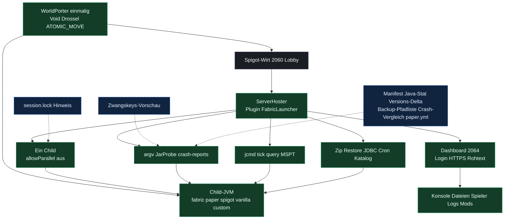

# ServerHoster

Spigot-Plugin, das auf einem Hoster mit nur Spigot einen Child-Server startet (Fabric, Paper, Spigot, Vanilla oder ein eigenes Jar) und das Web-Dashboard bereitstellt. Entwickelt wird diese Linie in diesem Repo.

Der Spigot-Name bleibt **FabricLauncher** (`de.aichele.childlauncher`). Konfiguration und Passwort liegen weiter in `plugins/FabricLauncher/`. Das Release-Jar heißt `ServerHoster-<version>.jar`.

Normalbetrieb ist **ein Child**. `allowParallel` steht in `config.yml` und ist aus. Ein Start stoppt die anderen Profile, Auto-Start gilt nur für `focusServer`. `allowParallel: true` lässt mehrere Profile gleichzeitig laufen.

Gameplay auf dem Fabric-Child bleibt vanilla. Lithium und FerriteCore sind die mitgelieferten Mods. WorldPorter ist optional und nur für den ersten Start.

Die ältere Kernlinie 1.1.0 liegt in [minecraft-fabric-launcher](https://github.com/Sciddie/minecraft-fabric-launcher). Neue Hoster-Änderungen entstehen hier.

## Feature-Matrix

Upgrade von FabricLauncher 1.0.0 mit Welt- und Konfigurationssicherung: [Migrationsleitfaden](docs/MIGRATION-FABRICLAUNCHER-1.0.0.md).

Grün ist live im Hoster-Repo 1.9.0. Blau und gestrichelt ist Idee.



Nächster Bau: Zwangskeys-Vorschau. Danach session.lock, nur lesen.

| Modul / Bereich | Feature-Name | Status (Live / Idee) | Nutzen / Mehrwert | Ressourcen-Impact (Minimal/Mittel) | Empfehlung (Ja/Nein/Optional) |
|---|---|---|---|---|---|
| Wirt | Spigot-Lobby | Live | Zap startet Spigot. Spiel liegt im Child. | Minimal | Ja |
| Child | Fabric, Paper, Spigot, Vanilla, Custom | Live | Ein Spielprozess. Typ in `config.yml`. | Mittel | Ja |
| Slot | Ein Child, `allowParallel` aus | Live | Start stoppt andere. Neustart lässt nach. | Minimal | Ja |
| Start | Auto-Restart, save-all, Shutdown-Hook | Live | Absturz kommt wieder. Stopp wartet. | Minimal | Ja |
| Plan | argv-Vorschau | Live | JVM-Zeile vor dem Start. Kein Download. | Minimal | Ja |
| Jar | JarProbe | Live | Name, Bytes, Pfad. Symlink bleibt zu. | Minimal | Ja |
| Crash | crash-reports lesen | Live | Absturztext. `../` und Symlink weg. | Minimal | Ja |
| Diag | jcmd und tick query | Live | Thread, Heap, Flags, MSPT. | Minimal | Ja |
| Mods | Lithium, Ferrite, Modrinth | Live | Nur diese Defaults. Toggle nach Neustart. | Minimal | Ja |
| Dash | Login, HTTPS, Rohtext | Live | `config.yml` und `server.properties` bleiben Text. | Minimal | Ja |
| Dash | Konsole, Dateien, Spieler, Logs | Live | Admin im Browser. | Mittel | Ja |
| Profile | Fokus, Cron, Zeitzone | Live | Zweites Profil liegt bereit. | Minimal | Ja |
| Backup | Zip, Liste, Restore, JDBC | Live | Archiv on demand. Keine lokale DB. | Mittel | Ja |
| Version | Katalog | Live | Liste holen. Nichts installieren. | Minimal | Ja |
| Porter | Void, Drossel, Welt-Move | Live | Einmal. Danach Jar löschen. | Minimal | Ja |
| Security | PathGuard | Live | Dashboard bleibt im Child-Ordner. | Minimal | Ja |
| Spigot | BuildTools beim Start | Live | Spigot-Jar erst wenn der Child startet. | Mittel | Ja |
| Props | Zwangskeys-Vorschau | Idee | Nächster Start zeigt Diff. Schreibt nicht. | Minimal | Ja |
| Start | session.lock Hinweis | Idee | Verwaiste Weltsperre sehen. Datei bleibt. | Minimal | Ja |
| Jar | Manifest Main-Class | Idee | Falsches Jar an der Klasse erkennen. | Minimal | Optional |
| Java | java-Binary stat | Idee | Gleicher Blick wie JarProbe. Wenig neu. | Minimal | Optional |
| Version | Installiert vs Katalog | Idee | Update sehen. Nicht laden. | Mittel | Optional |
| Backup | Pfadliste ohne Zip | Idee | Sehen, was ins Archiv käme. | Minimal | Optional |
| Crash | Zwei Reports vergleichen | Idee | Gleichen Absturz wiedererkennen. | Minimal | Optional |
| Paper | paper.yml Rohtext | Idee | Wie `server.properties`, nur bei Paper. | Minimal | Optional |
| Eula | eula.txt anzeigen | Idee | Start schreibt `eula=true` schon selbst. | Minimal | Optional |
| Auth | Mehrere Dashboard-User | Idee | Ein Admin-Passwort reicht. | Mittel | Nein |
| UI | Ingame-GUI | Idee | Bedienung bleibt im Dashboard. | Mittel | Nein |
| Daten | Lokale Datenbank | Idee | JDBC bleibt extern. H2 nur in Tests. | Mittel | Nein |
| Jars | Server-Jars vorladen | Idee | Download bleibt beim Start. | Mittel | Nein |
| Mods | Gameplay-Mods oder spark | Idee | Child bleibt vanilla plus Lithium/Ferrite. | Mittel | Nein |
| Porter | Ins Host-Jar ziehen | Idee | Einmal-Plugin bleibt eigenes Jar. | Minimal | Nein |
| Fabric | Hoster-Features dort bauen | Idee | Neue Arbeit bleibt im Hoster-Repo. | Minimal | Nein |
| Parallel | Zweiten Child ausbauen | Idee | Schalter existiert. Standard bleibt einer. | Mittel | Nein |
| Config | Task-Formular statt Rohtext | Idee | `config.yml` bleibt textarea. | Mittel | Nein |

## Server einrichten

Schritt für Schritt: **[docs/SETUP.md](docs/SETUP.md)**.

Kurz:

1. `ServerHoster-1.9.0.jar` nach `plugins/` legen.
2. Für den ersten Start zusätzlich `WorldPorter-1.4.0.jar`. Wenn `plugins/WorldPorter/done.marker` existiert, WorldPorter löschen.
3. Spigot starten. Dashboard-Passwort: `plugins/FabricLauncher/dashboard-password.txt`.

## Bauen

Java 25 und Maven.

```bash
mvn package
```

Das Jar liegt unter `target/ServerHoster-1.9.0.jar`. WorldPorter getrennt:

```bash
mvn -f worldporter/pom.xml package
```

`worldporter/target/WorldPorter-1.4.0.jar`. WorldPorter gehört nicht ins ServerHoster-Jar.

## Dokumentation

[docs/Dokumentation.md](docs/Dokumentation.md), HTML-Fassung [docs/Dokumentation.html](docs/Dokumentation.html).

Minimale Außenkonfiguration: `spigot-minimal-config/`.
