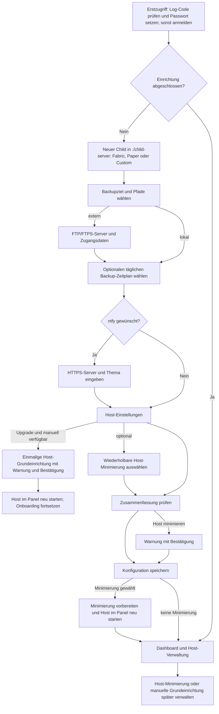

# Einrichtungswege und Entscheidungen

Bei einer Neuinstallation erfolgt die einmalige Host-Grundeinrichtung vor
dem ersten Dashboard-Aufruf automatisch. Bei Upgrades kann sie nur ausdrücklich
ausgelöst werden; erkannte alte Hostwelten werden dabei unwiderruflich gelöscht.
Ein Neustart muss im Hosting-Panel durchgeführt werden. Wird die Einrichtung
während des Onboardings ausgelöst, gehen noch nicht gespeicherte Eingaben verloren.

Nach einem Versionswechsel prüft der Assistent den Ordner aus `workingDir`.
Ist dort ein Child (`server.properties` oder eine JAR-Datei), zeigt er das an
und fragt nur Schritte, deren Angabe in der Konfiguration fehlt. Werte, die
eine Neuinstallation ohne weitere Eingabe setzt, kommen aus der aktuellen
Vorlage. Der gefundene Ordner bleibt. Fehlt keine Angabe, zeigt derselbe
Assistent **Update 2.5.1**.

Ist kein Child gefunden, fragt er nach dem Ordner oder nach einem neuen
Server. Der eingegebene Ordner wird geprüft. Passt er nicht, steht die
Meldung unter dem Eingabefeld, im gleichen Stil wie ein falsches
Dashboard-Passwort. „Neuen Server erstellen“ zeigt danach die Schritte einer
Neuinstallation, inklusive Versionswahl, und verwendet `./child-server`.

Der Assistent lädt keine Server-JARs herunter und startet den Child nicht.
RAM, JVM-Flags, weitere Backup-Zeitpläne und Child-`server.properties` können nach der
Einrichtung im Dashboard angepasst werden; sie sind keine Voraussetzung für
die Einrichtung. Der Serverordner ist `./child-server`.
